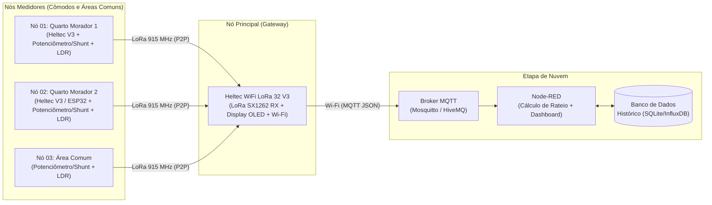

# Medidor de Energia Inteligente Residencial com Rateio via LoRa, MQTT e Node-RED

**Universidade Federal de São Paulo (UNIFESP) — Instituto de Ciência e Tecnologia (ICT - SJC)**  
**Disciplina:** Internet das Coisas (IdC)  
**Professor:** Prof. Dr. Gabriel de Freitas Fernandes  

---

## 1. Visão Geral do Projeto

Este projeto consiste em um **sistema IoT de medição e rateio inteligente de energia elétrica residencial**, projetado para dividir de forma justa a fatura mensal entre moradores de uma mesma residência (ex.: repúblicas, apartamentos compartilhados ou casas com múltiplos cômodos).

Cada cômodo (quarto individual ou área de uso comum, como sala, cozinha e lavanderia) possui um **Nó Medidor** que monitora a carga elétrica ativa e o estado de iluminação do ambiente. Os dados medidos são transmitidos sem fio via **LoRa (915 MHz)** para um **Nó Principal (Gateway)**, que publica as leituras via protocolo **MQTT** para uma aplicação na nuvem baseada em **Node-RED**, responsável por armazenar o histórico e calcular quanto cada morador deve pagar:

$$\text{Custo do Morador (R\$)} = \left( \text{kWh}_{\text{Individual}} + \frac{\sum \text{kWh}_{\text{Áreas Comuns}}}{N_{\text{Moradores}}} \right) \times \text{Tarifa Vigente}$$

---

## 2. Arquitetura do Sistema



### Hardware Utilizado
* **Microcontroladores e Transceptores LoRa:** Placas **Heltec WiFi LoRa 32 V3** (ESP32-S3 + Transceptor LoRa Semtech SX1262 915 MHz + Display OLED 0.96" I2C integrado) e **ESP32**.
* **Circuito de Medição em Bancada / PCI:**
  * **Sensoriamento de Carga Elétrica:** Potenciômetro em série com resistor limitador/shunt e filtro capacitivo (100 nF) ligado à porta analógica (ADC de 12 bits, 0–3,3 V).
  * **Detecção de Iluminação Acesa:** Fotoresistor (LDR) em divisor de tensão com resistor de 10 kΩ ligado à porta ADC.
  * **Placa de Circuito Impresso (PCI):** Placa dedicada para encaixe do Heltec V3 / ESP32 e componentes de medição.

---

## 3. Estrutura do Repositório

```text
├── Cópia de Requisitos, Especificações Técnicas e Testes.xlsx  # Planilha oficial de Requisitos e Testes
├── README.md                                                   # Guia principal do repositório
├── 01-requisitos/                                              # Documentação detalhada dos requisitos e testes
├── 02-circuito-e-pci/                                          # Esquemático, pinagem, arquivos da PCI e fotos
├── 03-firmware/                                                # Códigos-fonte (Nó Medidor LoRa TX e Gateway MQTT)
├── 04-nuvem-nodered/                                           # Tópicos MQTT, fluxos do Node-RED e Banco de Dados
├── 05-encapsulamento-3d/                                       # Arquivos CAD/STL do gabinete impresso em 3D
└── 06-apresentacao-e-evidencias/                               # Fotos/vídeos de validação e divisão de tarefas
```

---

## 4. Checklist de Entregas Obrigatórias e Pontuação

De acordo com as diretrizes da disciplina, **todos os 6 itens obrigatórios** devem estar presentes para que o projeto seja considerado entregue:

### Itens Obrigatórios (10 Pontos)
- [x] **1. Levantamento de Requisitos** *(1,0 pt — Documentação)* → Ver [`Cópia de Requisitos, Especificações Técnicas e Testes.xlsx`](./Cópia%20de%20Requisitos,%20Especificações%20Técnicas%20e%20Testes.xlsx) e [`01-requisitos/`](./01-requisitos/README.md)
- [x] **2. Versionamento de Código no Git** *(Obrigatório)* → Repositório estruturado
- [ ] **3. Validação de Circuito em Bancada** *(1,0 pt)* → Ver [`02-circuito-e-pci/`](./02-circuito-e-pci/README.md)
- [ ] **4. Uso de Comunicação LoRa** *(Obrigatório)* → Ver [`03-firmware/`](./03-firmware/README.md)
- [ ] **5. Validação da Etapa de Nuvem (MQTT + Node-RED)** *(2,0 pts)* → Ver [`04-nuvem-nodered/`](./04-nuvem-nodered/README.md)
- [ ] **6. Projeto, Confecção e Documentação da Placa de Circuito Impresso (PCI)** *(3,0 pts)* → Ver [`02-circuito-e-pci/`](./02-circuito-e-pci/README.md)
- [ ] **7. Apresentação com Evidências de Funcionamento e Arguição Individual** *(3,0 pts)* → Ver [`06-apresentacao-e-evidencias/`](./06-apresentacao-e-evidencias/README.md)

### Desafios Extras (+3 Pontos Extras)
- [ ] **Desafio Extra 1 (+1,0 pt):** Atualização remota de firmware (*OTA - Over-The-Air*) → Documentado em [`03-firmware/`](./03-firmware/README.md)
- [ ] **Desafio Extra 2 (+1,0 pt):** Implementação de Banco de Dados para histórico → Documentado em [`04-nuvem-nodered/`](./04-nuvem-nodered/README.md)
- [ ] **Desafio Extra 3 (+1,0 pt):** Projeto e impressão 3D de encapsulamento → Documentado em [`05-encapsulamento-3d/`](./05-encapsulamento-3d/README.md)

---

## 5. Contribuição de Cada Membro da Equipe

> **Observação Obrigatória da Disciplina:** *"Cada apresentação deve constar qual foi a contribuição de cada membro."*

| Integrante | Responsabilidades Principais | Etapas / Pastas Relacionadas |
| :--- | :--- | :--- |
| **Marco** | Levantamento de requisitos, arquitetura LoRa/MQTT, validação de circuito e integração | `01-requisitos/`, `02-circuito-e-pci/`, `03-firmware/` |
| *[Nome do Integrante 2]* | *(Preencher: ex. Projeto e confecção da PCI / Encapsulamento 3D)* | `02-circuito-e-pci/`, `05-encapsulamento-3d/` |
| *[Nome do Integrante 3]* | *(Preencher: ex. Etapa de Nuvem MQTT, Fluxo Node-RED e Banco de Dados)* | `04-nuvem-nodered/`, `06-apresentacao-e-evidencias/` |

---

## 6. Guia Rápido de Git para o Grupo

Para manter o histórico de versionamento organizado (critério avaliado na entrega):

```bash
# 1. Atualizar seu repositório local antes de começar a trabalhar
git pull origin main

# 2. Verificar quais arquivos foram alterados
git status

# 3. Adicionar os arquivos modificados ou criados
git add .

# 4. Registrar o commit com uma mensagem clara do que foi feito
git commit -m "docs: atualiza esquematico da PCI e testes de bancada"

# 5. Enviar para o repositório remoto (GitHub / GitLab)
git push origin main
```

### Padrão sugerido para mensagens de Commit:
* `docs:` para documentação, relatórios, planilha de requisitos e fotos.
* `feat:` para novas funcionalidades de firmware, fluxos do Node-RED ou arquivos da PCI.
* `fix:` para correções de bugs no código ou ajustes no circuito.
* `hw:` para atualizações de esquemático, layout da PCI ou modelo 3D do encapsulamento.
